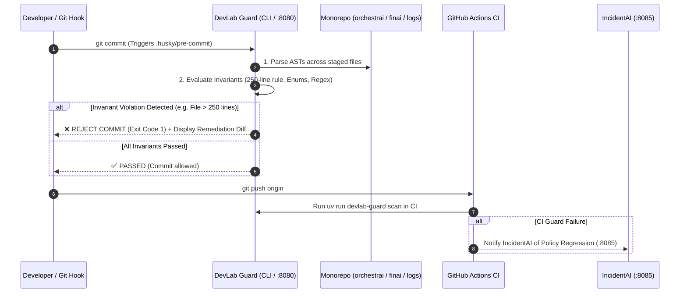

# DevLab Guard — Master Product Specification, Technical Dossier & Operations Manual

---

## 1. Product File: Strategic Vision & Architectural Governance

### 1.1 Executive Product Summary

**DevLab Guard** is the automated architectural policy engine, AST static analysis guardian, and code governance enforcement system for the DevLab multi-repo ecosystem (`orchestrai`, `finai`, `devlab-portal`, `devlab-shared`, `devlab-logs`, `incidentai`).

Standard linters (like ESLint, Ruff, or standard CI checks) verify basic syntax and style formatting, but fail to comprehend deep architectural invariants, cross-package dependency rules, domain enum usage, or file complexity caps. DevLab Guard fills this critical gap:
1. **Abstract Syntax Tree (AST) Inspection**: Analyzes TypeScript, Python, and Go code at the AST level using tree-sitter and native AST parsers rather than brittle regex pattern matching.
2. **Strict Architectural Invariant Enforcement**: Programmatically enforces the **250-line rule**, detects raw magic strings in domain comparisons, bans inline regular expressions, and stops hardcoded LLM model constants.
3. **Automated Multi-Lingual Quality Gate**: Runs seamlessly as a local git pre-commit hook, CI/CD pipeline blocker, and standalone HTTP service (`:8080`) providing real-time linting for IDE extensions.
4. **License & Legal Compliance Scanner**: Verifies open-source software licenses across monorepo dependencies and ensures proprietary copyright headers are intact.

### 1.2 Target Personas & Primary Use Cases

| Persona | Operational Context | Primary Pain Points Addressed |
| :--- | :--- | :--- |
| **Principal Architect** | Enforcing clean architecture and module boundaries across 7 repositories | Prevents architectural erosion, circular imports, and monolithic file bloat before code reaches pull requests. |
| **Software Engineer** | Writing daily TypeScript, Python, and Go code | Receives sub-second pre-commit feedback with actionable suggestions and automated AST-based diff recommendations. |
| **Security Engineer** | Preventing credential leaks and unvetted shell execution | Catches hardcoded API keys, dangerous `eval`/`exec` calls, and un-sandboxed shell executions at compile-time. |
| **Compliance Officer** | Auditing third-party licenses and legal risks | Automatically verifies that no GPL or copyleft packages contaminate proprietary enterprise packages. |

---

## 2. Exhaustive Feature Directory & Technical Mechanics

```
┌────────────────────────────────────────────────────────────────────────────────────────────────────────┐
│                                   DEVLAB GUARD ARCHITECTURE TOPOLOGY                                   │
└────────────────────────────────────────────────────────────────────────────────────────────────────────┘
            [CLI Command: uv run devlab-guard scan]    [FastAPI Server (Port 8080)]
                              │                                     │
                              └──────────────────┬──────────────────┘
                                                 ▼
                                     [AST Parser Subsystem]
                                 (Tree-sitter / Python AST)
                                                 │
     ┌───────────────────────────┬───────────────┴───────────────┬───────────────────────────┐
     ▼                           ▼                               ▼                           ▼
[Rule Engine: Invariants]  [Security Scanner]          [Reviewer & Diff Engine]    [Legal & Licenses]
 • 250-Line Maximum Rule    • Secret Detection          • AST-Aware Refactoring     • License Compatibility
 • Zero Magic String Enums  • Unsafe Shell Commands     • Automated Diffs           • Header Verification
 • Zero Inline Regexes      • SQL Injection Risks       • Markdown Annotations      • Dual-License Audit
 • Strict Import Boundaries • Capability Violations     • PR Comment Generation     • SBOM Generation
```

### 2.1 Core Module Breakdown

#### 1. AST Parser Subsystem (`src/devlab_guard/parser`)
- **Technology Stack**: Python 3.12, Tree-sitter bindings for TypeScript/Go, native `ast` module for Python.
- **Purpose**: Converts source code into lossless abstract syntax trees for deep semantic inspection.
- **Detailed Features**:
  - Multi-language AST extraction supporting TypeScript (`.ts`, `.tsx`), Python (`.py`), and Go (`.go`).
  - High-speed parallel traversal utilizing multi-core Python worker processes.

#### 2. Architectural Rule Engine (`src/devlab_guard/rules`)
- **Detailed Features**:
  - **`LineLimitRule`**: Counts physical and logical lines of code. Rejects any file exceeding **250 lines**. Emits a warning when a file reaches 200 lines to encourage early modular decomposition.
  - **`EnumRule`**: Examines AST binary expressions (`===`, `==`, `switch`). Flags any raw string literals compared against domain models, statuses, roles, or modes. Requires canonical enums (e.g. `ExecutionStatus.COMPLETED`).
  - **`RegexRule`**: Detects regex literals (`/.../`) and `new RegExp(...)` calls. Mandates that all regular expressions originate from central packages (`@orchestrai/regex`, `@yuva-devlab/regex`).
  - **`BoundaryRule`**: Enforces inward architectural flows. Blocks `@orchestrai/core` from importing sibling packages; blocks library packages from importing application layers.
  - **`ModelRule`**: Detects hardcoded LLM model candidate strings (e.g. `"gemma4:31b"`, `"qwen2.5:7b"`), enforcing dynamic database- or environment-driven configuration.

#### 3. Security & Vulnerability Auditor (`src/devlab_guard/security`)
- **Detailed Features**:
  - Scans AST nodes for high-risk operations: `child_process.exec`, `os.system`, `subprocess.Popen(shell=True)`.
  - Detects plaintext API keys, passwords, and private key strings using entropy analysis and token matching.

#### 4. Automated Reviewer & Diffs (`src/devlab_guard/reviewer`)
- **Detailed Features**:
  - Generates concrete, copy-pasteable refactoring diffs when a rule violation is detected.
  - Produces structured GitHub Actions pull request review comments with line numbers and rationale.

#### 5. FastAPI Service (`src/devlab_guard/server.py` — Port `8080`)
- **Technology Stack**: FastAPI, Uvicorn, Python 3.12.
- **Purpose**: High-speed HTTP server providing remote linting endpoints for IDE extensions and CI webhooks.

---

## 3. Inter-System Ecosystem Collaboration ("How It Works With Others")



### 3.1 Inter-Repository Integration Matrix

| Ecosystem Member | Direction | Protocol & Transport | Purpose & Operational Behavior |
| :--- | :---: | :--- | :--- |
| **`orchestrai`** | Inbound | CLI / Git Pre-commit | Scans 18 packages and 8 apps; enforces the 250-line maximum rule and strict enum usage. |
| **`finai`** | Inbound | CLI / Git Pre-commit | Guarantees that `@finai/finance-engine` remains pure with zero external dependencies and zero floating-point math. |
| **`devlab-shared`** | Inbound | CLI / Git Pre-commit | Ensures all 19 foundation packages have proper publish configs and strict TypeScript definitions. |
| **`devlab-logs`** | Inbound | CLI / Git Pre-commit | Validates Go agent formatting, Node.js ingest rules, and Kafka event models. |
| **`incidentai`** | Outbound | Webhook HTTP POST | Notifies IncidentAI if critical security or architecture regressions are introduced in CI. |

---

## 4. Technical Guidelines & Invariant Rules

### 4.1 Prime Non-Negotiable Invariants

1. **Python 3.12 & Astral uv Standard**:
   - DevLab Guard must be managed exclusively with `uv` (`pyproject.toml` + `uv.lock`). Zero bare `pip install`.
2. **Zero False Positives Bar**:
   - Rules must utilize AST context rather than naive regex text searching to avoid blocking legitimate string literals in tests or comments.
3. **Sub-Second Execution SLA**:
   - Staged git commits must be scanned and evaluated in < 800 milliseconds.

---

## 5. Developer Usage Guidelines & Operations Manual

### 5.1 Local Prerequisites & Setup

```bash
# Clone the repository
git clone https://github.com/yuvadevlab/devlab-guard.git
cd devlab-guard

# Sync Python environment using uv
uv sync

# Format and lint Python code
uv run ruff format
uv run ruff check --fix

# Start the local FastAPI server (:8080)
uv run uvicorn devlab_guard.server:app --port 8080 --reload
```

### 5.2 Running Architectural Scans

```bash
# Scan a specific file
uv run devlab-guard scan --path ../orchestrai/apps/gateway/src/index.ts

# Scan an entire repository
uv run devlab-guard scan --path ../orchestrai

# Check license compliance across dependencies
uv run devlab-guard verify-licenses --path .
```
