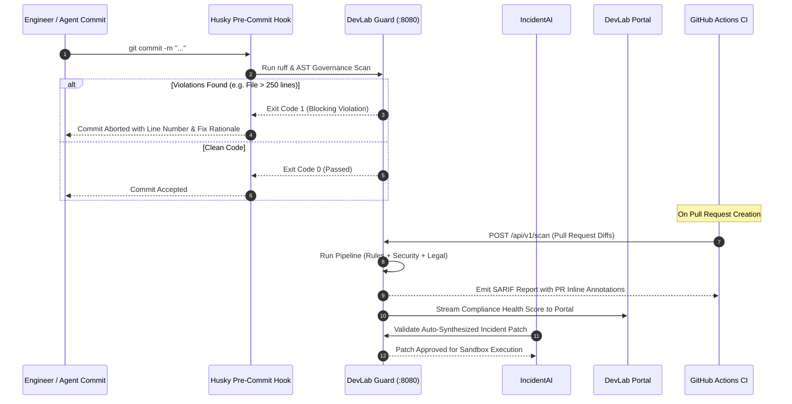

# DevLab Guard — Product Specification, Technical Dossier & Operations Manual

---

## 1. Executive Product Dossier & Market Vision

### 1.1 The Operational Problem Space
When autonomous AI agents (such as Antigravity, Claude Code, GitHub Copilot) collaborate alongside human software engineers in a high-scale monorepo ecosystem, **architectural erosion** occurs at unprecedented speed:
- **Monolith Sprawl**: Language models naturally append code to existing files rather than refactoring. Left unchecked, small 100-line components quickly balloon into 1,000+ line unmaintainable monoliths.
- **Contract & Enum Drift**: AI models frequently generate bare string literals (e.g. `status === "completed"`, `role === "user"`) instead of importing canonical shared enums, causing subtle runtime comparison bugs.
- **Missing Explanatory Context**: Generated code often lacks explanatory docstrings and rationale comments for complex conditionals, making future agent triage and reasoning uncertain.
- **Secret & Injection Vulnerabilities**: Automated agent tool loops risk accidentally committing API keys or hardcoding credentials into repository branches.

Traditional linters (like ESLint, Flake8, or Prettier) check stylistic syntax and formatting, but lack **semantic architectural governance rules** tailored to agentic software engineering.

### 1.2 The DevLab Guard Value Proposition
**DevLab Guard** is an **AST-driven code governance, architectural linting, and automated code review engine** built in high-performance Python with `uv` and `ruff`:
1. **Mathematical Modularity Enforcement**: Enforces the non-negotiable **Hard 250-Line Rule** across every repository.
2. **Multi-Language AST Introspection**: Powered by Python's native `ast` and Tree-sitter bindings to inspect code semantics across TypeScript, Python, and Go.
3. **Automated Security & Legal Defense**: Scans code for secrets, prompt injection vectors, license compliance (GPL contamination), and PII leaks.
4. **Autonomous LLM Auto-Fix Reviewer**: When violations are detected, Guard can synthesize automated patch suggestions and open pull requests.
5. **Universal Integration**: Functions as a zero-latency Git pre-commit hook (<300ms), a GitHub Actions CI blocking check, and a FastAPI webhook service (`:8080`).

---

## 2. Exhaustive Feature Matrix & Deep Technical Explanation

```
┌────────────────────────────────────────────────────────────────────────────────────────┐
│                              DEVLAB GUARD PIPELINE ARCHITECTURE                        │
└────────────────────────────────────────────────────────────────────────────────────────┘
 [Source Diffs / Files] ──▶ [1. Pipeline Runner] ──▶ [2. AST / Tree-sitter Parser]
                                                            │
    ┌───────────────────────┬───────────────────────────────┼────────────────────────────┐
    ▼                       ▼                               ▼                            ▼
[3. Core Rules]     [4. Security Engine]            [5. Legal Auditor]          [6. Auto-Reviewer]
 • 250-Line Limit    • Secret Scanner                • License Compliance        • LLM Client
 • JSDoc Exhaustion  • Prompt Safety Scanner         • PII Detector              • Prompt Builder
 • Enum Invariant    • Code Injection Detector                                   • Patch Generator
 • Strict Typing
    │                       │                               │                            │
    └───────────────────────┴───────────────────────────────┴────────────────────────────┘
                                                            │
                                                            ▼
                                        [7. SARIF / Terminal Reporter]
```

### Feature 1: Multi-Language AST Grammar Parser & Line Counter
- **Module**: `src/devlab_guard/parser/`
- **Objective**: Construct accurate concrete and abstract syntax trees and compute logical SLOC vs documentation.
- **How It Works**:
  - `ast_visitor.py`: Uses Python native `ast` for Python files and `tree_sitter_loader.py` for TypeScript, JavaScript, and Go.
  - `line_counter.py`: Strips empty whitespace and comments to measure both physical file length and true Source Lines of Code (SLOC).
- **Inputs**: File system paths to `.ts`, `.tsx`, `.py`, `.go` source files.
- **Outputs**: Syntax node trees and line count metrics.

### Feature 2: Core Architectural Rules Engine
- **Module**: `src/devlab_guard/rules/`
- **Rules Enforced**:
  - **`line_limit_rule.py` (DL-001)**: Emits a blocking error if any source file exceeds 250 physical lines. Emits early warnings at 200 lines to trigger decomposition into focused sub-modules.
  - **`jsdoc_rule.py` (DL-002)**: Scans exported symbols (functions, classes, interfaces, types) and asserts that complete JSDoc / docstring documentation exists with `@example` blocks.
  - **`enum_rule.py` (DL-003)**: Traverses binary comparisons (`===`, `==`, `switch`) to detect raw hardcoded domain strings (e.g. `"active"`, `"completed"`), enforcing imports from shared types enums.
  - **`strict_typing_rule.py` (DL-004)**: Flags explicit `any` usage in TypeScript and untyped parameters in Python.

### Feature 3: Security & Injection Defense Engine
- **Module**: `src/devlab_guard/security/`
- **Capabilities**:
  - **`secret_scanner.py`**: Scans diffs against high-entropy regex signatures from `@yuva-devlab/regex` to detect private keys, AWS tokens, GitHub PATs, and OpenAI API keys.
  - **`injection_scanner.py`**: Identifies unparameterized SQL queries, unsafe `eval()` / `exec()` calls, and shell execution vulnerabilities (`child_process.exec`, `subprocess.Popen(shell=True)`).
  - **`prompt_safety.py`**: Analyzes LLM prompt templates to detect jailbreak vulnerabilities and missing system instruction framing.

### Feature 4: Legal & Compliance Auditor
- **Module**: `src/devlab_guard/legal/`
- **Capabilities**:
  - **`license_auditor.py`**: Scans package manifests (`package.json`, `pyproject.toml`, `go.mod`) to detect viral copyleft licenses (GPL, AGPL) that could jeopardize proprietary IP.
  - **`pii_auditor.py`**: Scans code and test fixtures for leaked Personal Identifiable Information (emails, phone numbers, SSNs, credit cards).

### Feature 5: Autonomous LLM Auto-Fix Reviewer
- **Module**: `src/devlab_guard/reviewer/`
- **Objective**: Automatically generate patches to resolve detected rule violations without manual developer intervention.
- **How It Works**:
  - `prompt_builder.py`: Formulates a structured prompt including the offending code snippet, file context, and the exact rule violation.
  - `client.py`: Calls local or remote LLMs (Ollama / DevLab AI Client) to generate a compliant refactoring.
  - `patch_generator.py`: Validates that the refactored code splits large files cleanly, verifies the fix against the pipeline, and produces a unified diff patch.

### Feature 6: FastAPI Webhook & CI Server
- **Module**: `src/devlab_guard/server.py`
- **Objective**: Expose the governance pipeline over HTTP on port `8080`.
- **Endpoints**:
  - `GET /health`: Returns service health status and version.
  - `POST /api/v1/scan`: Ingests target directory paths and returns a structured `GuardReport` JSON payload.

---

## 3. How DevLab Guard Interacts with the Multi-Repo Ecosystem



### Detailed Ecosystem Interaction Matrix

| Ecosystem Member | Direction | Protocol / Transport | Data Payload / Contract |
| :--- | :---: | :--- | :--- |
| **`incidentai`** | Inbound | REST API (`:8080/api/v1/scan`) | Validates auto-synthesized SRE remediation patches against the 250-line rule before git commit. |
| **`devlab-portal`** | Outbound | REST API (`:3010`) | Streams repository architecture health scores (0-100%) and compliance audit events to the control plane. |
| **`orchestrai`** | Outbound | Git Pre-commit / CI CLI | Scans agent nodes, tools, and runtime packages on every commit to maintain monorepo invariants. |
| **`finai`** | Outbound | Git Pre-commit / CI CLI | Asserts that financial calculations remain pure and feature modals strictly adhere to the 2-file pattern. |
| **`devlab-shared`** | Static | Shared Regex Spec | Consumes regex token definitions from `@yuva-devlab/regex` for secret and PII detection. |

---

## 4. Technical Guidelines & Invariants

### 4.1 Language & Tooling Choices
- **Python 3.12 with Astral Toolchain (`uv` + `ruff`)**:
  - `uv` enables lightning package installs (<2s) and deterministic `uv.lock` pinning.
  - `ruff` replaces Black, Flake8, and isort, executing linter and formatting checks in single-digit milliseconds.
- **Pydantic v2**:
  - Enforces strict input validation on `GuardReport` and `RuleViolation` schemas.
- **FastAPI / Uvicorn**:
  - High-performance asynchronous REST API server running on port `8080`.

### 4.2 Governance Invariants
1. **The Hard 250-Line Maximum Rule (DL-001)**: Zero exceptions across `src/devlab_guard/`.
2. **Deterministic Exit Codes**: CLI returns exit code `0` on clean pass, and exit code `1` on any blocking violation.
3. **Pre-Commit Execution Budget**: Git pre-commit checks must complete in under 500ms to preserve developer velocity.

---

## 5. Complete Usage Runbook & Operations Manual

### 5.1 Installation & Setup
```bash
# Clone the repository
git clone https://github.com/yuvadevlab/devlab-guard.git
cd devlab-guard

# Install Python dependencies via uv
uv sync

# Verify ruff formatting and linting
uv run ruff format --check .
uv run ruff check .
```

### 5.2 CLI Command Reference
```bash
# Scan a specific file or repository
uv run python -m devlab_guard.cli check ../orchestrai

# Scan and automatically generate LLM fixes
uv run python -m devlab_guard.cli check ../orchestrai --fix

# Scan for secrets and security vulnerabilities only
uv run python -m devlab_guard.cli security ../finai

# Scan for software license compliance
uv run python -m devlab_guard.cli legal ../devlab-portal
```

### 5.3 Starting the REST API Server
```bash
# Start FastAPI server on port 8080
uv run uvicorn devlab_guard.server:app --host 0.0.0.0 --port 8080 --reload
```

### 5.4 Scanning via HTTP API
```bash
curl -X POST http://localhost:8080/api/v1/scan \
  -H "Content-Type: application/json" \
  -d '{
    "target_path": "/Users/yuvarajpattabi/Yuva/yuva-devlab/Repos/orchestrai",
    "auto_fix": false
  }'
```

### 5.5 Environment Variables Reference

| Variable | Type | Default | Description |
| :--- | :--- | :--- | :--- |
| `PORT` | Number | `8080` | HTTP port for FastAPI server. |
| `MAX_FILE_LINES` | Number | `250` | Maximum allowable lines per file before blocking error. |
| `WARN_FILE_LINES`| Number | `200` | Warning threshold to recommend decomposition. |
| `LLM_BASE_URL` | String | `http://localhost:11434` | Endpoint for Ollama / DevLab AI model inference for auto-fixes. |
| `LLM_MODEL` | String | `qwen2.5-coder:7b` | Model used for automated code refactoring. |
