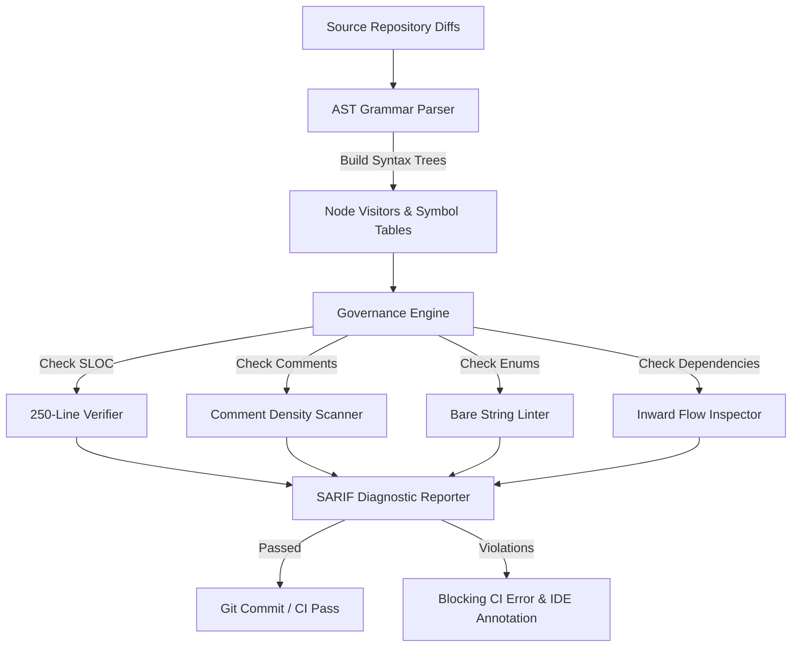

# DevLab Guard — Autonomous AST Governance, Architecture Linter & Code Analysis Engine

<p align="center">
  
  
  
  
  
</p>

**DevLab Guard** is an AST-driven code governance, architectural linting, and quality enforcement engine built in high-performance Python with `uv` and `ruff`. It statically analyzes source repositories across the DevLab multi-repo ecosystem to enforce non-negotiable architectural invariants: the hard 250-line rule, explanatory comment density, strict package boundaries, and zero magic numbers.

---

## ⚡ Core Governance Rules

| Rule | Enforcement Level | Description |
| :--- | :--- | :--- |
| **`DL-001` (250-Line Rule)** | **Blocking Error** | No source file may exceed 250 physical lines. Warnings emitted at 200 lines. |
| **`DL-002` (Comment Density)** | **Blocking Error** | Complex control branches (`if/else/switch`) must have preceding explanatory comments explaining the invariant being guarded. |
| **`DL-003` (Exhaustive JSDoc)** | **Blocking Error** | All exported classes, functions, and interfaces must have complete docstrings detailing parameters and returns. |
| **`DL-004` (Enum Invariant)** | **Blocking Error** | Domain statuses, roles, and event types must reference shared type enums, never bare string literals. |
| **`DL-005` (Boundary Check)** | **Blocking Error** | Core shared packages must never depend on higher-level applications. |

---

## 🏗 Architecture & Pipeline



---

## 🚀 Quick Start

### Prerequisites
- Python `>= 3.12`
- `uv` (fast Python package manager: `curl -LsSf https://astral.sh/uv/install.sh | sh`)

### Installation & Execution
```bash
# Clone the repository
git clone https://github.com/yuvadevlab/devlab-guard.git
cd devlab-guard

# Install dependencies via uv
uv sync

# Run governance analysis across a target repo
uv run python -m src.cli check ../orchestrai

# Run code format and lint checks
uv run ruff format --check .
uv run ruff check .
```

---

## 📁 Repository Structure

```
devlab-guard/
├── .agents/                    # Specialized AI agent definitions
│   ├── agents/                 # AST Parser, Governance Enforcer, Policy Engine
│   └── rules/                  # Core invariants and rulebooks
├── .husky/                     # Git hooks (Ruff format & conventional commit regex)
├── .vscode/                    # VS Code settings (Ruff format-on-save)
├── src/                        # Python AST governance source code
│   ├── ast_parser/             # Multi-language syntax tree parsing
│   ├── rules/                  # Modular governance rule validators
│   ├── reporter/               # Terminal pretty-printing & SARIF reports
│   └── cli.py                  # CLI command entrypoint
├── pyproject.toml              # Project dependencies and tool configurations
├── ruff.toml                   # Ruff linter and formatter settings
└── README.md                   # Project documentation
```
